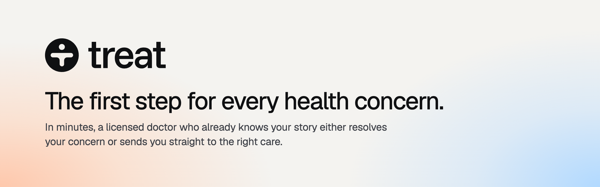

# Treat

**The first step for every health concern.** Tell Treat what's wrong in your own words. In minutes, a licensed doctor who already knows your story either resolves your concern or sends you straight to the right care: a prescription, a sick leave certificate, or a booking with your occupational health service. Treat also works out what your insurance and occupational healthcare cover, so you don't have to.

- Website: [treat.health](https://treat.health/en/)
- Careers: [Open roles at Treat](https://treat.health/en/careers/)
- Blog: [Treat blog](https://treat.health/en/blog/)

## How we build

Elixir, Phoenix LiveView, Ash and Oban at the core, with React, TypeScript, Tailwind, Rust and Nix, on GCP and Cloudflare, plus native Swift and Kotlin apps. Health data stays in the EU, every sign-in uses strong identification, and patient data never ends up in logs.

We're hiring: [Full-stack Engineer at Treat](https://treat.health/en/careers/full-stack-engineer/).
